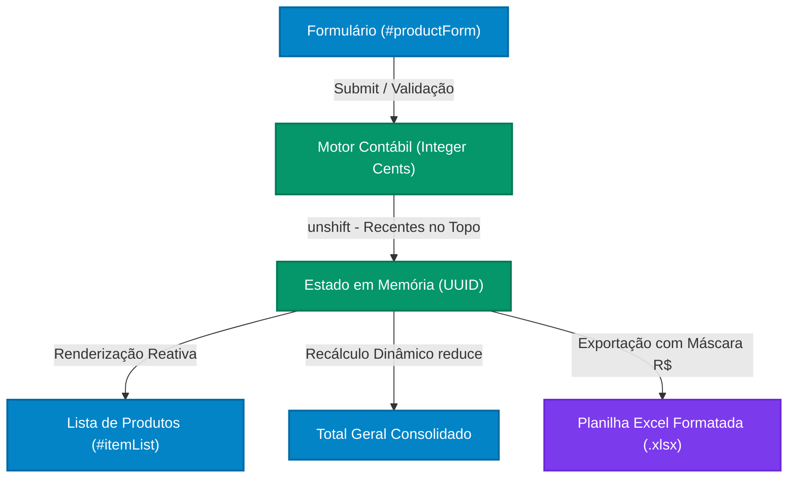
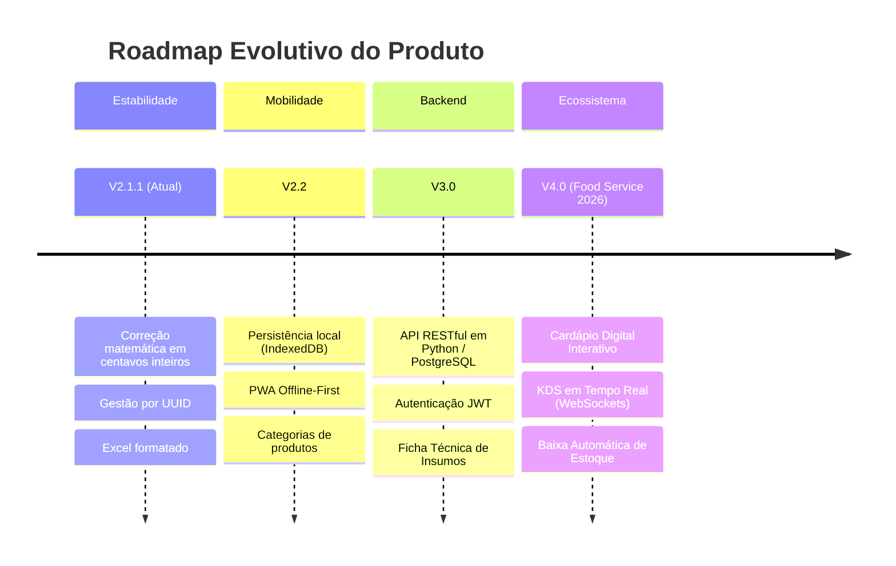

<div align="center">

# 📊 QuantumSheet — Controle de Produtos & Lista de Compras
### *Engenharia de Software, Precisão Contábil & Transformação Digital*

[](https://opensource.org/licenses/MIT)
[](https://developer.mozilla.org/en-US/docs/Web/JavaScript)
[]()
[]()

<br />

> **QuantumSheet** é uma solução web client-side projetada para o controle dinâmico, conferência física e orçamentária de produtos e insumos, com motor de cálculo financeiro determinístico, prevenção de perda de dados e exportação formatada para planilhas Excel (`.xlsx`).

</div>

---

## 🧭 Sumário

- [Visão Geral do Projeto](#-visão-geral-do-projeto)
- [Diagnóstico da Versão Anterior & Bugs Críticos](#-diagnóstico-da-versão-anterior--bugs-críticos)
- [Soluções Matemáticas & Correções de Engenharia](#-soluções-matemáticas--correções-de-engenharia)
- [Principais Funcionalidades da Versão Atual](#-principais-funcionalidades-da-versão-atual)
- [Arquitetura de Diretórios Refatorada](#-arquitetura-de-diretórios-refatorada)
- [Modelagem & Diagramas do Sistema](#-modelagem--diagramas-do-sistema)
- [Ciclo de Vida do Software (Roadmap)](#-ciclo-de-vida-do-software-roadmap)
- [Histórico de Branches & Preservação](#-histórico-de-branches--preservação)
- [Autor & Governança](#-autor--governança)

---

## 📌 Visão Geral do Projeto

O **QuantumSheet** integra a proposta de **Transformação Digital para Microempreendedores do Setor de Food Service e Varejo**, orientada no âmbito do Curso de Análise e Desenvolvimento de Sistemas da **Faculdade ESUDA**. 

A aplicação soluciona os gargalos clássicos do controle descentralizado em comandas de papel e planilhas manuais, oferecendo uma interface ágil e reativa capaz de totalizar compras de insumos, prevenir erros de digitação e gerar relatórios executivos prontos para contabilidade.

---

## 🔬 Diagnóstico da Versão Anterior & Bugs Críticos

Durante a auditoria técnica da versão anterior, foram detectadas falhas matemáticas e de integridade de dados que explicavam por que o valor acumulado apresentava divergências ("valores a mais ou a menos"):

| ID | Falha Encontrada | Causa Técnica | Impacto no Negócio |
| :--- | :--- | :--- | :--- |
| **BUG-01** | **Acúmulo cumulativo via `+=` e `-=`** | Incerteza de ponto flutuante binário (padrão IEEE 754) | Diferenças sutis de centavos acumuladas a cada adição/remoção. |
| **BUG-02** | **Descompasso Visual vs. Memória** | Subtotais mantinham dízimas em memória, mas a tela exibia `.toFixed(2)` | A soma das linhas visíveis na tela não batia com o Total Geral. |
| **BUG-03** | **Corrupção de Índice na Busca (Crítico)** | `renderList(filtered)` passava o índice posicional filtrado para `items.splice(index, 1)` | **Ao excluir/editar com filtro ativo, apagava o item errado do topo da lista principal**, destruindo a matemática. |
| **BUG-04** | **Edição Destrutiva** | O item era excluído imediatamente ao clicar em editar | Risco de perda permanente do registro se o formulário não fosse salvo. |
| **BUG-05** | **Exportação desformatada** | Dados eram despejados como floats puros | Planilhas Excel com números desformatados e colunas estreitas cortando texto. |

---

## ⚡ Soluções Matemáticas & Correções de Engenharia

Para eliminar integralmente esses problemas e garantir **100% de precisão contábil**, foram implementados novos padrões de engenharia:

### 1. Motor Financeiro Baseado em Centavos Inteiros (`Integer Cents`)
Ao invés de operar decimais fracionados, os valores são tratados como centavos inteiros usando notação científica exponencial `e2` (eliminando anomalias onde `35.855 * 100` virava `3585.4999999999995`):

```javascript
// Conversão determinística para centavos inteiros
function toCents(amount) {
    return Math.round(Number(amount + 'e2'));
}

// Cálculo do subtotal estritamente contábil
function calculateItemSubtotal(quantity, unitPrice) {
    const unitPriceCents = toCents(unitPrice);
    const itemCents = Math.round(quantity * unitPriceCents);
    return fromCents(itemCents);
}
```

### 2. Recálculo Declarativo e Consistente (`calculateGrandTotal`)
Eliminou-se a variável global de acúmulo. O total consolidado é **sempre recalculado dinamicamente** através da soma dos centavos inteiros de cada linha:

$$\text{Total Geral} = \frac{\sum_{i=1}^{n} \text{toCents}(\text{subtotal}_i)}{100}$$

> **Garantia Contábil:** A soma de cada linha exibida na tela é **rigorosamente idêntica** ao Total Geral, sem desvio de 1 centavo sequer.

### 3. Chave Primária Universal (`UUID`)
Cada produto cadastrado recebe uma chave imutável (`crypto.randomUUID()`). A edição e exclusão operam exclusivamente pelo ID único, tornando o sistema **100% imune a erros ao buscar ou filtrar produtos**.

---

## 🚀 Principais Funcionalidades da Versão Atual

- 📥 **Inserção com Recentes no Topo:** O último item cadastrado é inserido imediatamente no início da listagem (`unshift`), garantindo agilidade na visualização.
- ✏️ **Modo de Edição Seguro:** Interface com botões alternáveis de **"Salvar Edição"** e **"Cancelar"** (não-destrutivo).
- 🔍 **Busca Reativa Instantânea:** Filtragem dinâmica de produtos sem impacto no estado global de dados.
- 📊 **Exportação Excel (.xlsx) Profissional:**
  - Colunas formatadas com larguras padronizadas (evita textos cortados).
  - Máscara de moeda contábil brasileira oficial (`"R$" #,##0.00`).
  - Reconhecimento nativo de números pelo Excel (pronto para fórmulas e gráficos).
- 🛡️ **Proteção de Sessão (`beforeunload`):** Impede o fechamento acidental da aba se houver produtos na lista.

---

## 📂 Arquitetura de Diretórios Refatorada

O projeto foi estruturado seguindo os princípios de **Clean Code** e **Arquitetura Modular Baseada em Recursos**:

```text
QuantumSheet/
│
├── docs/                                  # Governança, Documentação e Especificações
│   ├── Documentacao_Tecnica_V2.1.docx     # Especificação técnica executiva completa em Word
│   └── Diagramas e Organogramas/          # Repositório Oficial de Diagramas e Modelagens
│       ├── diagramas_sistema.md           # Modelagens estruturais e comportamentais em Mermaid
│       └── *.pdf, *.png, *.svg            # Diagramas BPMN, UML, Classes, Sequência e Arquitetura
│
├── src/                                   # Raiz do Código-Fonte Modularizado
│   ├── core/                              # Camada Global de Infraestrutura
│   │   └── utils/
│   │       └── currency.js                # Motor puro de cálculo contábil e conversões financeiras
│   └── modules/                           # Módulos de Domínio de Negócio
│       └── shopping_list/
│           ├── services/
│           │   └── shopping_list.service.js # Serviço de regras de negócio do carrinho
│           └── types/
│               └── item.types.js          # Tipagens e modelos conceituais de dados
│
├── assets/                                # Ativos Estáticos e Script de Produção
│   ├── app.js                             # Script de execução oficial em produção (auditado)
│   ├── QuantoSheet.png                    # Favicon oficial
│   └── QuantoSheet_2.png                  # Logotipo institucional
│
├── comentado/                             # Versão Educacional e Didática
│   └── app.js                             # Código comentado passo a passo para auditoria
│
├── styles/                                # Camada de Apresentação e Estilo
│   └── styles.css                         # Folha de estilos responsiva
│
├── index.html                             # Ponto de Entrada da Aplicação Web
├── README.md                              # Documentação de apresentação do repositório
└── .gitignore                             # Filtro de arquivos de sistema e temporários
```

---

## 📐 Modelagem & Diagramas do Sistema

Todos os diagramas de engenharia e processos estão documentados em detalhes na pasta [`docs/Diagramas e Organogramas/`](file:///d:/Arquivos%20de%20Backup/01-Backup%20Unidade%20Pricipal_01_07_24/Documentos/Projetos/Oracle%20Next%20Education/Lista_Compras/2.1/docs/Diagramas%20e%20Organogramas/):



* **BPMN As-Is & To-Be:** Mapeamento do fluxo manual em papel versus a orquestração digital integrada.
* **Diagrama de Casos de Uso (UML):** Mapeamento de atores (Cliente, Cozinha, Gestor) e operações.
* **Diagrama de Classes de Domínio:** Entidades orientadas a objetos (`Produto`, `Pedido`, `Estoque`, etc.).
* **Diagrama Entidade-Relacionamento (ER):** Esquema relacional ACID projetado para PostgreSQL.
* **Diagrama de Sequência:** Linha temporal de emissão de eventos e notificação em tempo real.
* **Diagrama de Arquitetura em Camadas:** Visão tecnológica (Client PWA $\rightarrow$ Proxy $\rightarrow$ API $\rightarrow$ DB).

---

## 📈 Ciclo de Vida do Software (Roadmap)



---

## 🌿 Histórico de Branches & Preservação

- **`main`**: Branch principal contendo a versão atual auditada (V2.1.1), com correções matemáticas, árvore de diretórios modularizada, documentação executiva e README profissional.
- **`Old`**: Branch secundária preservando integralmente o estado histórico anterior do projeto para fins de rastreabilidade e governança.

---

## 👨‍💻 Autor & Governança

* **Desenvolvedor & Arquiteto:** [Glaucio Luiz Cavalcanti](https://github.com/GlaucioCavalcanti)
* **Orientação Acadêmica:** Prof. Edgar Gregório — *Interfaces Digitais UX/UI e Engenharia de Software*
* **Instituição:** Faculdade ESUDA — Recife/PE

---
<div align="center">
  <sub>Desenvolvido com foco em Qualidade de Software, Arquitetura Limpa e Confiabilidade Matemática.</sub>
</div>
